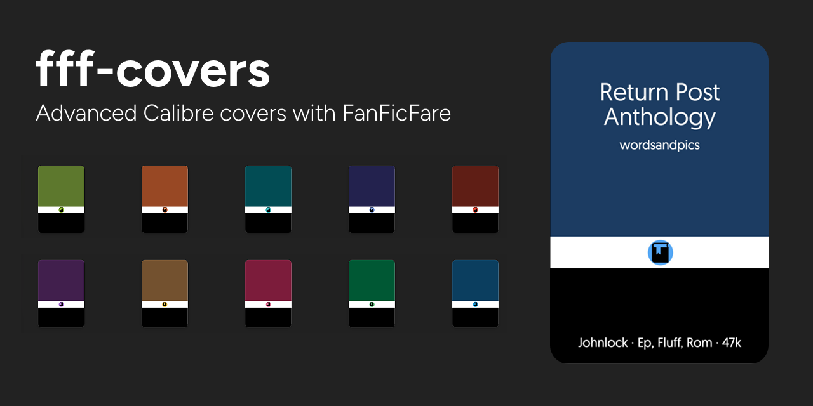

# fff-covers

If you have opinions about fanfic, a Calibre library that has gotten slightly out of hand, and a ~~nagging~~  persistent feeling that the default grey cover is a crime against aesthetics: this guide is for you.

**fff-covers** is a beginner-friendly guide to automatic covers for fanfiction downloaded with FanFicFare and managed in Calibre. Start with one working cover, then choose which information and automatic cover rules are useful for your own library.

***

## 📖 Read the guide

### **[wordsandpics.github.io/fff-covers](https://wordsandpics.github.io/fff-covers)**

***

## ⬇️ Downloads

**[Classics preset](code/classics_preset.zip)** — the starter Generate Cover preset used throughout the guide.

**[Colour cover backgrounds](code/wordsandpics_classic_covers.zip)** — optional SVG backgrounds in several colours. Extract the ZIP and select an individual SVG in Generate Cover.

***

## What's covered

Start with one working automatic cover in Step 1. The rest of the four-step path lets you add only what you want:

1. Create your first cover.
2. Set up your artwork (optional).
3. Add AO3 metadata to Calibre when you want story details on covers.
4. Generate covers with that metadata.

After that, the guide is organized by what you want to do:

- **Cover content:** word and chapter count, status, ships, genres, and advanced display options for finished fields.
- **Choose a cover:** select artwork by fandom, ship, AO3 tag, or title length; give Original Works their own design and protect hand-chosen covers.
- **Advanced options:** anthology-aware ships, chapter-aware status, precise matching, metadata cleanup, covers from existing EPUBs, and the optional likeability score.
- **Reference:** troubleshooting, downloads, changelog, and contact information.

The [Ship code generator](https://wordsandpics.github.io/fff-covers/display/ships/code-generator/) and [Genre code generator](https://wordsandpics.github.io/fff-covers/display/genres/code-generator/) build repetitive Calibre template code without requiring you to write it by hand.

***

## Changelog

See the [guide's changelog](https://wordsandpics.github.io/fff-covers/reference/changelog/) for updates.

***

## License

[MIT](LICENSE) — use it, adapt it, share it.
